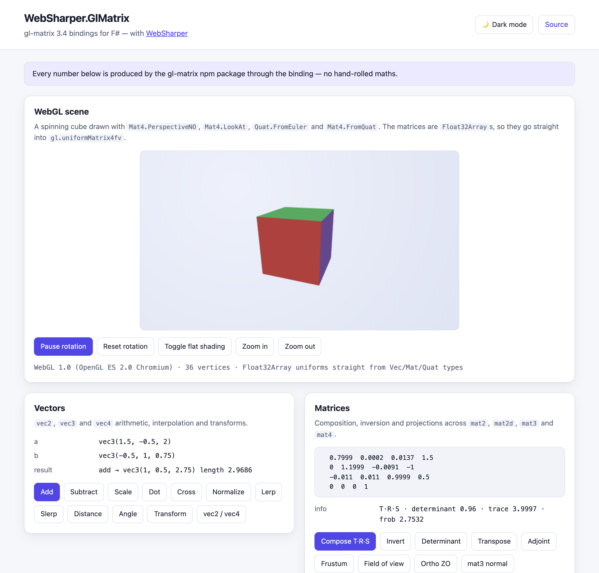

# WebSharper.GlMatrix

[](https://www.nuget.org/packages/WebSharper.GlMatrix)

WebSharper bindings for [gl-matrix](https://glmatrix.net/), the high-performance
matrix and vector library for WebGL, tracking **gl-matrix 3.4**.

The binding maps every gl-matrix module to a strongly typed F# class whose values
are real `Float32Array`s, so they can be handed to WebGL calls such as
`gl.UniformMatrix4fv` without conversion:

```fsharp
let projection = Mat4.PerspectiveNO(Mat4.Create(), 45., 4. / 3., 0.1, 1000.)
let eye = Vec3.FromValues(0., 0., 5.)
let view = Mat4.LookAt(Mat4.Create(), eye, Vec3.FromValues(0., 0., 0.), Vec3.FromValues(0., 1., 0.))

gl.UniformMatrix4fv(uProjection, false, projection)
gl.UniformMatrix4fv(uView, false, view)
```

This repository contains:

| Project | Purpose |
| --- | --- |
| `WebSharper.GlMatrix` | The binding: WIG definitions for `glMatrix`, `mat2`, `mat2d`, `mat3`, `mat4`, `quat`, `quat2`, `vec2`, `vec3` and `vec4`. |
| `WebSharper.GlMatrix.Sample` | A static SPA that exercises the whole surface: a WebGL cube plus vector, matrix, quaternion and utility readouts. |

## Live demos

**Try it live:** [Open the sample in your browser](https://dotnet-websharper.github.io/glmatrix/)



The sample doubles as the binding's [test case](#running-the-test-case): a
spinning cube drawn with `Mat4`, `Vec3` and `Quat`, plus buttons for every
module family (`vec2/3/4`, `mat2/2d/3/4`, `quat`, `quat2`, `glMatrix` helpers,
`forEach` traversal and `mat2.LDU`).

- **Sample (this repository):** <https://dotnet-websharper.github.io/glmatrix/>
- **Source repository:** <https://github.com/dotnet-websharper/glmatrix>
- **WebSharper bindings:** <https://websharper.com/bindings>
- **Upstream:** <https://github.com/toji/gl-matrix>

## Features

| gl-matrix module | Binding | Notes |
| --- | --- | --- |
| `glMatrix` | `GlMatrix` | `Round`, `ToRadian`, `ToDegree`, `Equals`, `Epsilon`, `AngleOrder`, `SetMatrixArrayType`. |
| `vec2`, `vec3`, `vec4` | `Vec2`, `Vec3`, `Vec4` | Full arithmetic, interpolation (`Lerp`, `Slerp`, `Hermite`, `Bezier`), transforms, `forEach`, plus the short aliases (`Sub`, `Mul`, `Div`, `Dist`, `SqrDist`, `Len`, `SqrLen`). |
| `mat2`, `mat2d`, `mat3`, `mat4` | `Mat2`, `Mat2d`, `Mat3`, `Mat4` | Creation, composition, `Invert`, `Adjoint`, `Determinant`, `Frob`, `LDU`, projections (`PerspectiveNO`/`PerspectiveZO`, `OrthoNO`/`OrthoZO`, `Frustum`, `LookAt`, `TargetTo`, `PerspectiveFromFieldOfView`) and decomposition (`GetTranslation`, `GetRotation`, `GetScaling`, `Decompose`). |
| `quat` | `Quat` | 24 operations plus the `vec4`-backed aliases (`Clone`, `FromValues`, `Set`, `Add`, `Scale`, `Dot`, `Lerp`, `Normalize`, …), `FromEuler` with `EulerOrder`, `RotationTo`, `Sqlerp`, `SetAxes`. |
| `quat2` | `Quat2` | Dual quaternions: construction from a rotation + translation (or a `Mat4`), `GetTranslation`, `Rotate*`, `RotateByQuatAppend/Prepend`, `RotateAroundAxis`, `GetReal`/`SetReal`, `GetDual`/`SetDual`. |
| All value types | | Inherit `Float32Array` (`Length`, `Get`/`Set`, `Subarray`) and expose component accessors (`X`/`Y`/`Z`/`W`) plus an indexer for matrices. |

## Installation

```bash
dotnet add package WebSharper.GlMatrix
```

```fsharp
open WebSharper.GlMatrix
```

The binding imports gl-matrix from its npm package (per-module subpaths such as
`gl-matrix/mat4`) and records the reference version as an npm dependency
(`>= 3.4.4 < 4.0.0`), so a bundler such as esbuild or Vite that resolves `npm`
packages works out of the box.

## Usage

### Matrices and WebGL

The matrices are `Float32Array`s, which is exactly what the WebGL uniform calls
expect:

```fsharp
let projection =
    Mat4.PerspectiveNO(Mat4.Create(), 45., aspect, 0.1, 1000.)

let model =
    Mat4.FromRotationTranslation(Mat4.Create(), rotation, position)

let modelView =
    Mat4.Multiply(Mat4.Create(), view, model)

gl.UniformMatrix4fv(uModelView, false, modelView)
```

`PerspectiveNO`/`OrthoNO` map the near and far clip planes to the WebGL
clip-space Z range `[-1, 1]`; `PerspectiveZO`/`OrthoZO` map to `[0, 1]`, which is
what WebGPU, Vulkan, DirectX and Metal use. The old `Perspective` and `Ortho`
names still exist as `Obsolete` aliases of the `NO` variants.

### Quaternions

```fsharp
let rotation =
    Quat.FromEuler(Quat.Create(), pitch, yaw, roll, EulerOrder.ZYX)

let oriented = Mat4.FromQuat(Mat4.Create(), rotation)

// Interpolate between two orientations.
let half = Quat.Slerp(Quat.Create(), from, target, 0.5)
```

`EulerOrder` is the intrinsic rotation order (`XYZ`, `XZY`, `YXZ`, `YZX`,
`ZXY`, `ZYX`); omitting it uses `GlMatrix.AngleOrder`, which gl-matrix defaults
to `"zyx"`.

### Dual quaternions

`Quat2` carries a rotation and a translation in one value, which is handy for
skinning and for composing rigid transforms:

```fsharp
let dq = Quat2.FromRotationTranslation(Quat2.Create(), rotation, translation)
let position = Quat2.GetTranslation(Vec3.Create(), dq)
```

### In-place operations and null results

Like the JavaScript API, most operations write into an `out` argument and return
it, and the aliases are kept: `Vec3.Add(out, a, b)`, `Vec3.Sub(out, a, b)`,
`Mat4.Mul(out, a, b)`, `Vec3.Dist(a, b)`, `Vec3.Len(a)`, and so on.

`Invert` is the only family that can fail; it returns an option instead of the
null that gl-matrix reports:

```fsharp
match Optional.toOption (Mat4.Invert(Mat4.Create(), m)) with
| Some inv -> // ...
| None ->     // the matrix is singular
```

### Notes on the API

* Every module function is mapped, including the short aliases gl-matrix
  re-exports (`mul`, `sub`, `div`, `dist`, `sqrDist`, `len`, `sqrLen`, `len`,
  `forEach`). The aliases are documented on the corresponding member.
* `Vec*` and `Mat*` constructors wrap an existing `Float32Array` without
  copying: `Vec3(float32Array)`.
* `GlMatrix.SetMatrixArrayType` takes the JavaScript constructor object
  (`JS.Global?Float32Array` or `JS.Global?Array`) and is typed as `obj` because
  a JS constructor has no .NET counterpart. Changing it makes `Create()` return
  plain arrays instead of typed arrays.
* `mat2.LDU` mirrors upstream exactly: it fills the lower-triangular `L` and
  `U`, and leaves `D` untouched, so `L·D·U` is not a complete factorization.
* The binding is generated from the gl-matrix 3.4.4 TypeScript declarations and
  source; the surface is compared module by module when a new 3.x release
  appears.

## Running the test case

Build the sample in Release (this also bundles the npm package with esbuild) and
serve its static output:

```bash
dotnet build WebSharper.GlMatrix.Sample/WebSharper.GlMatrix.Sample.fsproj -c Release
dotnet tool install -g dotnet-serve   # once
dotnet serve -d dist -p 8080
```

Then open <http://localhost:8080/>:

* the WebGL cube spins using `Mat4.PerspectiveNO`, `Mat4.LookAt`,
  `Quat.FromEuler` and `Mat4.FromQuat`; the buttons pause the rotation, reset it,
  switch between lit and flat shading, and move the camera;
* the vector, matrix and quaternion cards run every operation family and show
  the numbers gl-matrix produces;
* the utilities card covers `GlMatrix` helpers, in-place `forEach` traversal
  (with and without the extra argument) and `mat2.LDU`;
* the header switches between the light and dark themes and remembers the
  choice.

## Build from source

The repository uses [Paket](https://fsprojects.github.io/Paket/). The sample
targets `net10.0`; the binding targets `netstandard2.0`.

```bash
dotnet tool restore
dotnet paket restore
dotnet build WebSharper.GlMatrix.Sample/WebSharper.GlMatrix.Sample.fsproj -c Release
```

`./build` (or `build.cmd` on Windows) runs the build-stack targets, for example:

```bash
./build WS-Package          # pack the NuGet package
./build CI-Release          # build, update dependencies, tag
```

## Pack

```bash
./build WS-Package
# or, without the build stack:
WSPackageFolder=/tmp/pkg dotnet fsi ./build.fsx -t WS-Package
```

The package contains `WebSharper.GlMatrix.dll`, its `.xml` documentation and the
WebSharper 11 `.websharper` metadata sidecar.

## Deployment

`.github/workflows/ghpages.yml` builds the sample in Release on `.NET 11`
(preview) and publishes `dist/` to GitHub Pages on every push to `main`. The
screenshot in `docs/sample.png` is a real capture of that build.

## Repository layout

| Path | Contents |
| --- | --- |
| `WebSharper.GlMatrix/Main.fs` | The WIG definition (one class per gl-matrix module). |
| `WebSharper.GlMatrix.Sample/` | The sample: `Client.fs`, `index.html`, `site.css`, `esbuild.config.mjs`, `package.json`. |
| `dist/` | Build output of the sample (generated, not committed). |
| `docs/sample.png` | The sample screenshot used in this README. |
| `nuget/` | The Paket pack template. |

## License

Apache 2.0 — see [LICENSE.md](LICENSE.md). gl-matrix itself is MIT licensed.